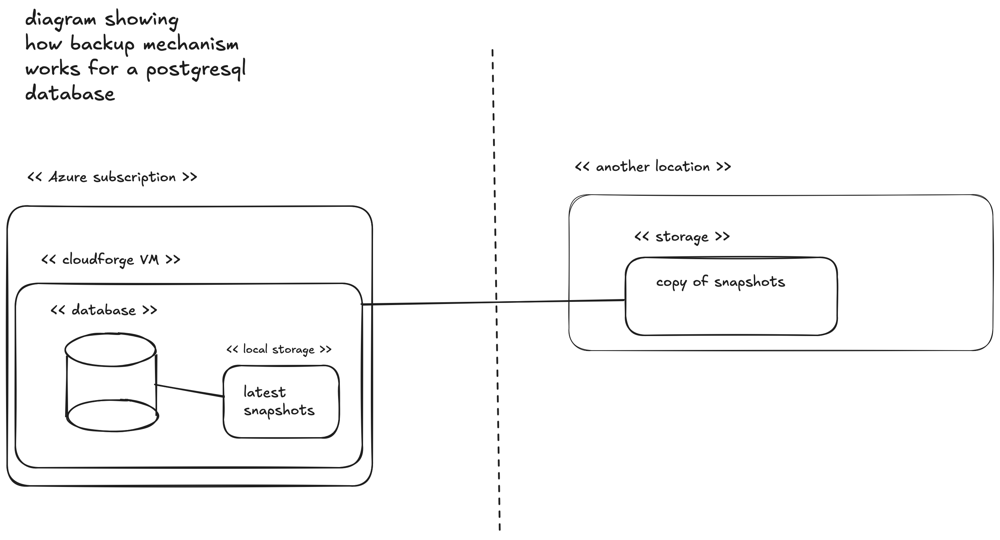

Mes nouveaux projets nécessitent l'utilisation de bases de données. Le projet le plus récent adopte l'approche _local-first_, ce qui signifie que l'application conserve et transforme les données principalement sur la machine locale. Ça peut être un laptop, un smartphone ou un IoT. Cependant, pour assurer le partage des données entre plusieurs machines, on utilise un serveur infonuagique disponible 24/7 sur Internet où les multiples appareils peuvent synchroniser leurs données.

L'approche _local-first_ permet de réduire la complexité inhérente à des systèmes client-serveur traditionnels. Et surtout, ça me permet de réduire les coûts.

Le premier enjeu rencontré est de ne pas avoir le contrôle total sur mon compte infonuagique. Il serait possible que les ressources de ce compte soient modifiées ou que le compte lui-même disparaisse. Le premier requis est donc de traiter notre infrastructure comme éphémère, surtout les données qui y sont stockées.

### disaster recovery plan

En termes d'infrastructure et de configuration _as code_, je suis capable de remonter le système sur Azure en moins de 30 minutes, si je ne me presse pas. Pour ce qui est des données contenue dans une base de données `Postgresql`, je rajoute une vingtaine de minutes pour être réaliste.

Je touche du bois. Mais si ce n'est pas possible sur Azure, alors je peux lancer manuellement une VM Debian sur autre fournisseur infonuagique, rouler le même Ansible playbook, et utiliser le même processus pour restaurer le backup de base de données.

La plupart des utilisateurs ne se rendront probablement pas compte de l'incident puisqu'ils travaillent principalement sur leurs propres machines. Pendant la non-disponibilité du serveur, leurs données ne seront pas synchronisées. Une fois le service rétabli, l'application procédera naturellement à la synchronisation.

Cependant, la synchronisation ne fonctionnant plus, les utilisateurs travaillant en équipe sur les mêmes fichiers devront prendre une pause-café en attendant le rétablissement du service (fika!).

En termes de _Recovery Point Objective_ (RPO), aucune donnée ne sera perdue. La source de vérité restant les données sur la machine des utilisateurs, ce qui nous enlève une source de stress.

En termes de _Recovery Time Objective_ (RTO), après l'alerte, nous estimons pouvoir revenir en ligne au maximum une heure après avoir diagnostiqué un incident.

### backups et restore

J'ai calqué le design du système automatisé de sauvegarde sur la philosophie _local-first_. C'est-à-dire que le backup va vivre sur mon PC personnel!

Le serveur de synchronisation et sa base de données assurent la fédération des données. Il est publiquement disponible sur Internet et roule 24/7. Dans mon contexte, c'est un serveur qui m'est prêté et pourrait à tout moment devenir indisponible. Pas simplement le serveur, mais l'ensemble du compte Azure.

Donc, pour le backup je veux être 100% indépendant du cloud. Le stockage sur mon ordinateur personnel est gratuit. Le seul hic c'est qu'il n'est pas toujours allumé et qu'il n'est pas disponible sur Internet.

#### les requis

- les backups doivent se faire à chaque heure sur le serveur
- la prise de sauvegarde doit être extrêmement rapide
- la prise de sauvegarde ne doit pas ralentir les opérations
- les backups doivent être encryptés en tout temps
- ça doit être gratuit ; je ne veux pas payer un autre fournisseur infonuagique pour entreposer ces backups
- le processus de restauration d'un backup doit être extrêmement facile

#### restic, l'outil de sauvegarde choisi

Sauf pour la restauration du backup sur le serveur de base de données qui nécessite une intervention humaine, le processus de prise de sauvegarde est entièrement automatisé.

À la suite de la recommendation unanime de la communauté, j'ai opté pour l'outil de sauvegarde et restauration [restic](https://github.com/restic/restic). C'est un outil de sauvegarde performant, efficace et sécurisé. Il s'inspire du programme `git` en se contruisant autour de la notion de `repository` pour faciliter les manipulations autour de la prise de sauvegarde et de la restauration d'un snapshot. Il combine l'économie d'espace disque des sauvegardes incrémentales tout en assurant l'intégrité des fichiers des sauvegardes complètes.

J'apprécie l'emphase mise par son auteur sur le processus de restauration. La valeur d'une sauvegarde tient à la facilité et au taux de succès de la restauration d'un snapshot. Pour ma part, depuis l'adoption de ce système de sauvegarde j'ai participé deux fois à un exercice de _disaster recovery_ (DR). Malgré un problème n'étant pas lié à `restic` lors du premier exercice, dans les deux cas j'ai été capable de restaurer les données sur un nouveau serveur `postgresql` de façon satisfaisante en moins de deux.

#### les détails de l'automatisation

Sur le serveur à la source de la sauvegarde, j'ai simplement utilisé un [Systemd Timer](https://manpages.debian.org/testing/systemd/systemd.timer.5.en.html) qui déclenche une commande de sauvegarde `restic` sur les fichiers liés à la base de données. Toutes les heures, `restic` prend un snapshot de l'état de la database. Pour garder la sauvegarde légère, on ne conserve que le dernier snapshot.

Comme je ne veux pas envoyer les données dans un storage localisé dans le même compte Azure ni payer pour du storage sur un autre compte, comme AWS ou GCP, je veux envoyer le backup sur mon ordinateur personnel où j'ai du stockage en masse et pas cher.

Comme mon ordinateur personnel n'est pas accessible depuis Internet, je configure le transfert en mode _pull_. À intervale régulier, tant que mon ordinateur est allumé, il va se connecter au serveur de production pour télécharger la dernière version de la sauvegarde.

Je clone le même repository `restic` sur ma machine locale. C'est un miroir du repository du serveur de production. Ainsi, je vais pouvoir utiliser le même mot de passe `restic` pour décrypter la sauvegarde ainsi qu'utiliser le binaire `restic` pour restaurer la base de données.

Finalement, tout comme ce que je fais sur le serveur de production, j'ai configuré un `Systemd Timer` sur mon ordinateur personnel. Sur ma machine locale, cette tâche programmée lance à un intervalle supérieur à une heure, mais moins de 90 minutes, une commande [rsync](https://manpages.debian.org/trixie/rsync/rsync.1.en.html) qui se connecte via `ssh` sur le serveur de production pour copier de façon performante le repository `restic` où se trouve la sauvegarde la plus récente.

  
   
  <em>Schéma du mécanisme de sauvegarde d'une base de données PostgreSQL avec restic.</em>

#### monitoring et opérations

Pour l'instant, comme il n'y a pas beaucoup d'utilisateurs et qu'une panne n'est pas un problème urgent à régler, il n'y a aucun monitoring sophistiqué de l'infrastructure ou des services qui y roulent.

Toutefois, pour la sauvegarde, j'effectue depuis cet été un exercice mensuel où je recrée le système à partir de zéro dans un environnement sandbox, je restaure la base de données avec le dernier backup et valide que le service est 100% fonctionnel.

Ces exercices me permettent d'identifier les faiblesses du système de sauvegarde et confirment à chaque fois que c'est un système efficace qui permet de refaire vivre le service sans perte de données en peu de temps.

### sources

Wikipedia/restic: <https://en.wikipedia.org/wiki/Restic>

GitHub: <https://github.com/restic/restic>

Changelog -  Restic has your backup (Interview): <https://www.youtube.com/watch?v=NWec_ggU0aY>

[socraticDev's Cloudforge backup strategy](https://github.com/socraticDevBlog/cloud_forge/tree/main/docs/operations)
